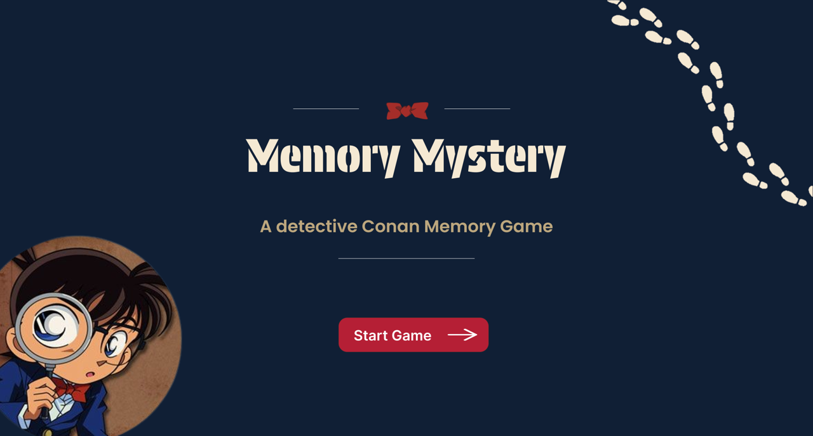
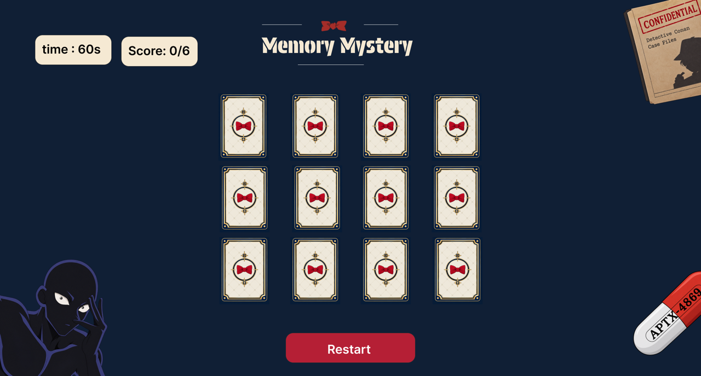
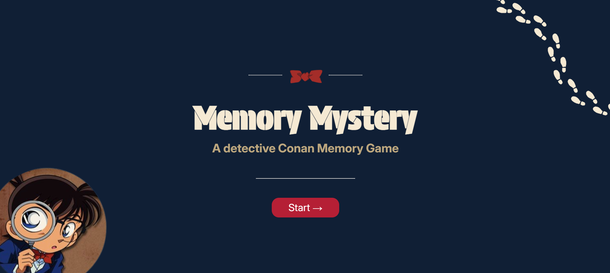
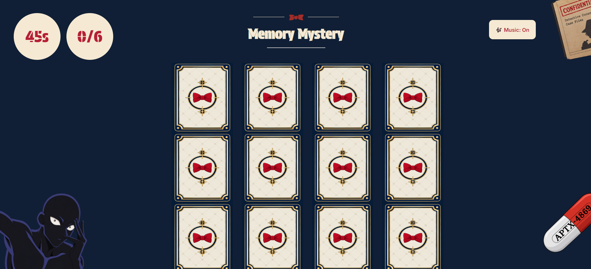
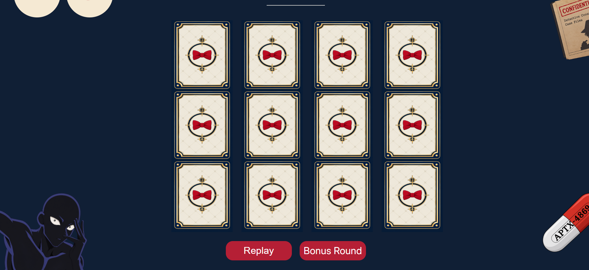

# Memory Mystery Game

## Description
A Detective Conan-inspired memory game where players match character pairs within 45 seconds and test their Detective Conan knowledge in a bonus round.

## Technologies used
1. HTML
2. CSS
3. JavaScript

## User Stories
1. As a user, I want to see a welcome page with the game title and a Start Game button so that I can begin the memory challenge.

2. As a user, I want to flip over 12 cards and match the 6 pairs of identical characters so that I can test my memory and earn points.

3. As a user, I want to see my correct-match score out of five and a countdown timer.

4. As a user, I want the game to end when I match all five pairs or when the timer reaches zero.

5. As a user, I want to play a bonus round of Detective Conan trivia questions on a separate page and earn extra points.

## Figma Prototype

## Screenshots

## Future Enhancements
1. Add a bonus round where the user can gain extra points by answering some detective conan trivia questions

## Credits
 1. https://developer.mozilla.org/en-US/docs/Web/CSS/Reference/Properties/object-position , this refrence was used for fixing the postion of the decorative images in the pages
 
 2. https://developer.mozilla.org/en-US/docs/Web/CSS/Reference/Values/clamp this refrence was used for fixing the postion of the decorative images in the pages

 3. https://sweetalert2.github.io/ this refrence was used to display winning and losing messages

 4. https://developer.mozilla.org/en-US/docs/Web/Media/Guides/Autoplay? , https://developer.mozilla.org/en-US/docs/Web/HTML/Reference/Elements/audio? These refrences were used for the adding of the audio (background music)

 5. https://developer.mozilla.org/en-US/docs/Web/CSS/Reference/Properties/transition used for card flipping transtion 

