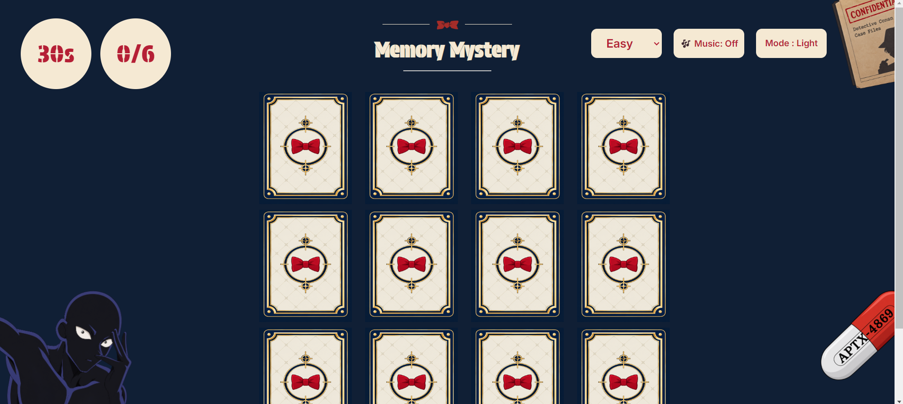

# Memory Mystery Game

## Description
A Detective Conan-inspired memory game where players match character pairs within a specific amount of time based on the level selected: easy or hard.

## Technologies used
1. HTML
2. CSS
3. JavaScript

## User Stories
1. As a user, I want to see a welcome page with the game title and a Start Game button so that I can begin the memory challenge.

2. As a user, I want to choose between easy and hard level modes , and flip cards and match the identical characters so that I can test my memory and earn points.

3. As a user, I want to be able to choose between dark and light mode

4. As a user, I want to be able to play and pause the background music.

5. As a user, I want to see my correct-match score out of 6 or 8 and a countdown timer.

6. As a user, I want the game to end when I match all five pairs or when the timer reaches zero.

## Figma Prototype

## Screenshots

## Future Enhancements
1. Add a bonus round where the user can gain extra points by answering some detective conan trivia questions

2. Add a Winning streak where it gets reseted everytime the user loses a round

## Credits
 1. https://developer.mozilla.org/en-US/docs/Web/CSS/Reference/Properties/object-position , this refrence was used for fixing the postion of the decorative images in the pages
 
 2. https://developer.mozilla.org/en-US/docs/Web/CSS/Reference/Values/clamp this refrence was used for fixing the postion of the decorative images in the pages

 3. https://sweetalert2.github.io/ this refrence was used to display winning and losing messages

 4. https://developer.mozilla.org/en-US/docs/Web/Media/Guides/Autoplay? , https://developer.mozilla.org/en-US/docs/Web/HTML/Reference/Elements/audio? , https://stackoverflow.com/questions/14356956/playing-audio-after-the-page-loads-in-html These refrences were used for the adding of the audio (background music)

 5. https://developer.mozilla.org/en-US/docs/Web/CSS/Reference/Properties/transition used for card flipping transtion 

